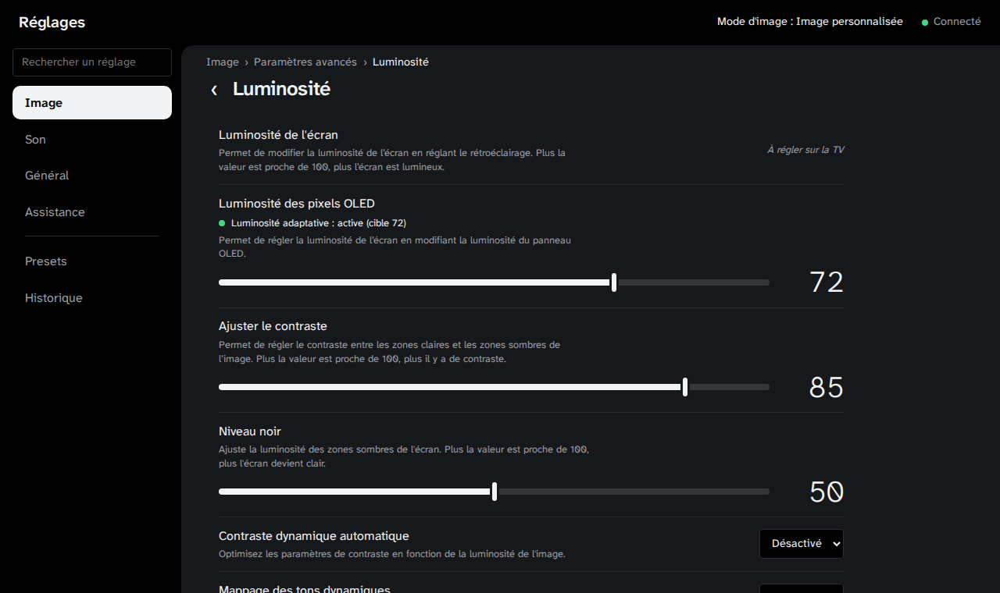

# LG webOS TV pour Home Assistant

> **English** — A Home Assistant integration (HACS) for LG webOS TV
> settings: picture, sound and general settings become Home Assistant
> entities, synchronized in real time both ways (remote control → Home
> Assistant, Home Assistant → TV, every write confirmed by the TV). It adds
> actions for automations (set a setting only in a given picture mode,
> apply a preset), an event when a setting is changed with the remote,
> adaptive OLED brightness driven by an ambient light sensor, and a sidebar
> panel that
> mirrors the TV's Settings menu with presets and undo history. Setting
> names and the panel are in **French** (they mirror the French menu of the
> LG OLED G5, webOS 25). Works with webOS 11.2 firmwares, where LG blocks
> direct settings writes for unsigned clients.

Les réglages de votre téléviseur LG dans Home Assistant : des entités
synchronisées en temps réel dans les deux sens, des actions et un événement
pour les automatisations, et le menu Réglages du téléviseur, en français,
dans la barre latérale.



## Fonctionnalités

- **Entités** générées depuis l'arborescence du menu : curseurs (luminosité
  des pixels OLED, contraste…), listes (mode d'image, TruMotion, économie
  d'énergie…), interrupteurs, capteurs. Les réglages d'usage courant sont
  activés d'emblée, les autres créés désactivés.
- **Synchronisation bidirectionnelle** : un réglage fait à la télécommande
  met l'entité à jour aussitôt ; une commande depuis Home Assistant est
  appliquée puis confirmée par le téléviseur (l'état affiché est toujours
  celui du téléviseur, jamais une valeur supposée).
- **Automatisations** :
  - action `lg_webos_tv.regler`, avec une garde facultative sur le mode
    d'image ;
  - action `lg_webos_tv.appliquer_preset` et un bouton par preset ;
  - événement « Réglage modifié sur le téléviseur » quand un réglage est
    changé à la télécommande, pour qu'une automatisation cède la main.
- **Luminosité adaptative** : la luminosité des pixels OLED suit un capteur
  de lumière ambiante, et cède la main à tout réglage manuel.
- **Panneau « LG webOS TV »** dans la barre latérale : le menu Réglages
  complet (y compris les réglages que l'API n'expose pas, affichés « À
  régler sur la TV »), recherche d'un réglage (sans tenir compte des
  accents, réglable directement depuis les résultats), état de la
  luminosité adaptative sur la ligne des pixels OLED (avec « Reprendre »
  pendant une pause) et page dédiée à la fonction, presets exportables en JSON et appliqués après
  aperçu des changements, historique avec retour arrière ; reste
  consultable quand le téléviseur est éteint (dernières valeurs connues).

## Téléviseurs pris en charge

L'arborescence est celle du **LG OLED G5 (webOS 25)**, testée sur les
firmwares 33.31.68 et 43.21.77 (webOS 11.2). Sur d'autres modèles LG webOS,
la plupart des réglages courants devraient fonctionner, mais l'arborescence
peut différer. Les retours sur d'autres modèles sont bienvenus.

Depuis webOS 11.2, le téléviseur réserve l'écriture directe des réglages aux
applications signées par LG : l'intégration écrit alors par le pont des
alertes système, et passe en **consultation** seulement si cette voie est
fermée (détails dans [`docs/incidents-ecriture.md`](docs/incidents-ecriture.md)).

## Installation

Prérequis : Home Assistant 2026.10 ou plus récent, [HACS](https://hacs.xyz),
téléviseur allumé et joignable, avec « LG Connect Apps » (contrôle réseau)
autorisé. Une adresse IP fixe (réservation DHCP) est recommandée.

1. HACS → menu ⋮ → Dépôts personnalisés → ajouter
   `https://github.com/Zanuuu/ha-lg-webos-tv`, catégorie **Intégration**.
2. Installer « LG webOS TV », puis redémarrer Home Assistant.
3. Paramètres → Appareils et services → Ajouter une intégration →
   « LG webOS TV » (le téléviseur peut aussi être découvert automatiquement).
4. Saisir l'adresse du téléviseur, puis accepter la demande d'appairage
   « Réglages TV (Home Assistant) » sur son écran (elle expire au bout de
   deux minutes).

Si le téléviseur refuse un jour la clé d'appairage (par exemple après une
mise à jour de son logiciel), Home Assistant propose de refaire l'appairage.
Changer d'adresse : menu ⋮ de l'intégration → Reconfigurer.

## Entités

Toutes appartiennent à l'appareil « LG webOS TV ». Les noms sont les
libellés du menu du téléviseur ; un libellé ambigu hors de son écran est
précédé de son menu (« Image — Mode Sélection », « Balance des blancs —
Méthode »).

| Type | Exemples | Remarque |
|---|---|---|
| Liste (`select`) | Mode Sélection (mode d'image), TruMotion, Fonction Économie d'énergie | options = libellés du menu |
| Curseur (`number`) | Luminosité des pixels OLED, Ajuster le contraste, Niveau noir | bornes du menu |
| Interrupteur (`switch`) | Protection des yeux, Compatibilité eARC, SIMPLINK | |
| Capteur (`sensor`) | Son — Mode Sélection, Pays | réglages en lecture seule |
| Bouton (`button`) | Appliquer le preset Soirée | un par preset |
| Luminosité adaptative | Luminosité adaptative (`switch`), État de la luminosité adaptative (`sensor`), Reprendre la luminosité adaptative (`button`) | si un capteur de lux est configuré |
| Événement (`event`) | Réglage modifié sur le téléviseur | `manuel` ou `autre_application` |
| Diagnostic | Connexion, Écriture des réglages impossible, Voie d'écriture | |

**Réglages d'image et mode d'image.** Le téléviseur garde une valeur par
mode d'image : une entité de réglage d'image montre et modifie la valeur du
mode **actif**, indiqué par son attribut `mode_image`. Changer de mode met
à jour toutes ces entités.

N'est exposé que ce dont la correspondance avec l'API est entièrement
connue ; le reste reste accessible dans le panneau.

## Automatisations

### Régler un réglage seulement dans un mode d'image

```yaml
action: lg_webos_tv.regler
data:
  entity_id: number.lg_webos_tv_luminosite_des_pixels_oled
  valeur: 60
  mode_image: cinema   # n'écrit que si le mode Cinéma est actif
response_variable: resultat
```

Sans `mode_image`, la valeur s'applique au mode actif. Avec, l'action ne
fait rien si un autre mode est actif et le dit dans sa réponse
(`ok: false`) sans faire échouer l'automatisation. `valeur` accepte un
nombre, un libellé du menu (`Cinéma`) ou une valeur API (`cinema`), on/off.

### Appliquer un preset

Créer le preset dans le panneau (entrée « Presets » de sa barre latérale), puis :

```yaml
action: lg_webos_tv.appliquer_preset
data:
  nom: Soirée
```

Le mode d'image du preset est appliqué en premier, puis les réglages
capturés pour ce mode. La réponse liste les réglages appliqués et ceux en
échec. Chaque preset a aussi son bouton.

### Céder la main à la télécommande

L'entité « Réglage modifié sur le téléviseur » émet un événement `manuel`
quand un réglage est changé à la télécommande ou par les réglages rapides
(une seule fois par réglage, à la fin d'un glissement de curseur), avec les
attributs `entree_id`, `libelle`, `cle`, `valeur` et `mode_image`. Les
changements faits par Home Assistant et les valeurs qui suivent un
changement de mode ne le déclenchent pas.

## Luminosité adaptative

Depuis la page **Luminosité adaptative** du panneau, ou Paramètres →
Appareils et services → LG webOS TV → **Configurer** : choisir un capteur
de luminosité ambiante (lux) active la fonction et crée ses trois entités ;
effacer le capteur la retire (l'intégration est alors rechargée).

La page du panneau montre l'état en direct (lux lissé et dernière mesure,
profil du capteur, luminosité calculée, luminosité du téléviseur, mode
d'image), la **cause d'une pause** et son heure de fin, avec « Reprendre »
ou « Pause 1 h » ; la **courbe** lux → luminosité, dont on déplace les deux
points à la souris, au doigt ou au clavier ; l'**emplacement du capteur**
avec un schéma de la pièce ; les autres réglages (capteur, durée de pause,
modes laissés de côté, réglages avancés repliés), appliqués sans recharger
l'intégration ; et un **journal** des 50 derniers événements (applications,
pauses, reprises, mesures écartées, conflits, erreurs), tenu en mémoire
depuis le démarrage de Home Assistant.

- Échelle logarithmique, proche de la perception de l'œil, entre une pièce
  sombre (luminosité minimale) et une pièce lumineuse (luminosité
  maximale).
- **Mesure fiabilisée** : le lux est lissé (plus vite quand la lumière
  monte que quand elle baisse), la luminosité n'est recalculée que si la
  lumière a changé d'au moins +10 % / −20 % depuis la dernière
  application, une mesure isolée plus de 4 fois plus forte ou plus faible
  attend 8 s ou une deuxième mesure, et les mesures sont mises de côté 5 s
  après chaque changement de luminosité (le capteur peut voir l'écran). Un
  grand changement de lumière se suit donc en quelques pas espacés de 5 s.
  Un changement plus petit que l'écart minimal (3 par défaut) est ignoré.
- **Profil du capteur**, déduit de son intégration (ZHA, Zigbee2MQTT, Hue,
  Z-Wave JS…) puis de la fréquence observée de ses mesures : il n'ajuste
  que le lissage et la confirmation des sauts, jamais la courbe. Ces
  constantes peuvent être fixées à la main (réglages avancés).
- **Emplacement du capteur** : à côté de l'écran, tourné vers la pièce, est
  recommandé ; face à l'écran (au canapé), la mise de côté passe à 20 s,
  et les emplacements déconseillés sont signalés.
- **Fonctions du téléviseur** : si « Fonction Économie d'énergie » n'est pas
  sur Désactivé, ou en mode d'image Éco, le téléviseur règle déjà lui-même
  la luminosité ; la fonction n'écrit plus rien, l'état devient
  `conflit_economie_energie` et une alerte apparaît dans Paramètres →
  Réparations. L'économie d'énergie se désactive par le bouton de la page
  ou par « Corriger » dans Réparations (jamais sans action de votre part).
  « Lumière ambiante du MODE FILMMAKER » et « Paramètres de luminosité AI »
  ne sont pas lisibles par l'intégration : la page explique leur effet.
- **Capteur figé** : sans mesure depuis plus de 3 fois son intervalle
  habituel (au moins 2 h), téléviseur allumé, la luminosité est conservée,
  l'état devient `capteur_fige` et une alerte apparaît dans Réparations.
- Réappliquée quand le téléviseur rappelle une autre luminosité : il en
  garde une par mode d'image **et par entrée**.
- **Pause** dès que la luminosité OLED est réglée ailleurs : télécommande,
  réglages rapides, autre application, entité ou panneau Home Assistant,
  preset, retour arrière. Les autres réglages ne comptent pas. La pause
  dure le délai choisi (120 min par défaut), ou jusqu'au prochain allumage
  du téléviseur ou au bouton « Reprendre » ; elle survit à un redémarrage
  de Home Assistant.
- **Modes laissés de côté** (par défaut FILMMAKER MODE, Expert et les
  contenus HDR / Dolby Vision) : la luminosité n'y est jamais modifiée. Un
  mode absent de la liste (« Créateur » par exemple) est aussi laissé de
  côté.
- L'entité « État de la luminosité adaptative » dit ce que fait la
  fonction (`active`, `pause`, `mode_exclu`, `conflit_economie_energie`,
  `capteur_indisponible`, `capteur_fige`…), avec les attributs `lux`,
  `lux_filtre`, `cible`, `fin_pause`, `cause_pause` (origine du réglage qui
  l'a mise en pause), `conflit`, `profil`, `emplacement` et
  `derniere_erreur`. Ses
  écritures apparaissent dans l'historique du panneau (origine
  « Luminosité adaptative »), et peuvent y être annulées.

## Écriture sous webOS 11 et mode consultation

Chaque modification est confirmée par la notification du téléviseur (ou,
à défaut, une relecture) : une valeur refusée (hors plage) fait échouer
l'action avec un message. Si le téléviseur n'autorise plus aucune voie
d'écriture, l'intégration passe en consultation : les réglages restent
suivis en temps réel, une alerte apparaît dans Paramètres → Réparations, et
l'écriture se réactive d'elle-même si un logiciel ultérieur la rouvre.

Certains réglages sont volontairement en lecture seule : leur écriture
s'est révélée dangereuse lors des essais (le pays, notamment, réinitialise
en cascade d'autres réglages).

## Dépannage

- **Entités indisponibles** : téléviseur éteint ou injoignable ; vérifier
  l'adresse et « LG Connect Apps ». La connexion est retentée seule.
- **Écriture refusée** : la valeur sort de la plage acceptée dans le mode
  d'image actif.
- **Diagnostics** : menu ⋮ de l'intégration → Télécharger les diagnostics
  (adresse et clé masquées).

## Données

L'historique et les presets sont stockés dans `<config>/lg_webos_tv/`
(inclus dans les sauvegardes de Home Assistant) ; la clé d'appairage dans
l'entrée de configuration.

**Venir de l'app (add-on) LG webOS TV 1.x** : exporter les presets depuis
l'app (« Exporter »), installer l'intégration, les réimporter dans le
panneau, puis désinstaller l'app.

## Développement

Intégration Python dans `custom_components/lg_webos_tv/`, panneau React /
Vite dans `frontend/`, arborescence des menus en JSON déclaratif. Tests,
build du panneau, publication, notes techniques :
[`docs/developpement.md`](docs/developpement.md).

Les contributions sont bienvenues : signalements, corrections de
l'arborescence pour d'autres modèles, traductions.

## Licence et mentions

Code sous licence [MIT](LICENSE).

Projet communautaire, non affilié à LG Electronics ni approuvé par elle.
LG, webOS et le logo webOS sont des marques de leurs propriétaires
respectifs.
